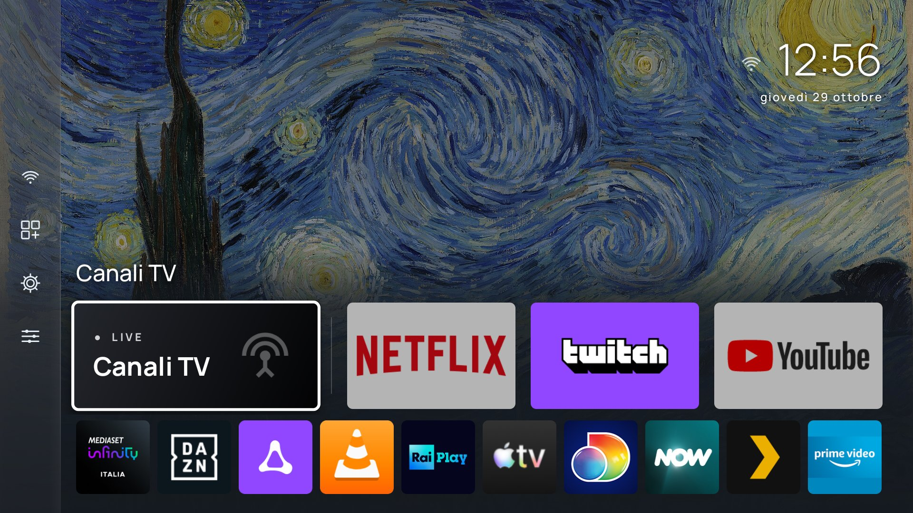

# Salotto

A fork of [Homestead](https://github.com/Sarg338/Homestead): a home screen for Fire TV with no
ads. It also takes over the Home button, which Fire OS normally doesn't let any app do.

Salotto started from Homestead and now goes its own way. It has its own look, its own
settings and a Canali TV page for Italian live TV.



**Not for Vega OS.** The newest Amazon sticks (Fire TV Stick 4K Select and the 2026 Fire TV
Stick 4K, the ones without "Plus" or "Max") run Vega OS. It isn't Android and takes no APK, so
Salotto can't run on them. The Plus and Max run Fire OS.

## What it does

- Puts your inputs, TV apps and everything else on one screen. No sponsored rows, no
  autoplaying trailers, no promoted tiles.
- Opens when you press Home, in about 170 ms, instead of Amazon's home screen.
- Shows HDMI and Composite inputs as tiles. On a TV with its own input menu (the TCL), an
  **Inputs** entry in the side rail opens that menu.
- Has a **Live TV** tile on TVs with a tuner. It opens the last channel you watched. **Live TV
  first** (Settings, Content & order) makes it the large first tile, and Home always lands
  on it.
- Has a **Canali TV** page with tabs for Rai and Mediaset. Every Mediaset channel and radio
  opens Mediaset Infinity on that channel.
- Has a **Search** entry in the side rail. It finds your apps and the Canali TV channels by
  name; you type with the arrows and OK on a keyboard of letters.
- Can be controlled from a phone. Turn on **Phone remote** (Settings, Behaviour; off by
  default), press *Pair a phone* and scan the QR code. The phone gets a page with the remote's
  buttons, the search (typing is quicker there) and forms for the main settings: background,
  columns, clock, which apps are hidden, the screensaver and a few more. The code changes every
  minute and works once; how long a phone stays signed in is a setting. It answers only
  inside your home network and is plain HTTP (see [SECURITY.md](SECURITY.md)). The buttons
  need the debugging link of [Setup](#setup).
- Sorts apps by how often you use them, counted on the TV. Press MENU on a tile, or hold
  Select, to hide it.
- Offers a few backgrounds: gradients, plain black for OLED screens and night, four
  public-domain paintings (Starry Night, The Great Wave, The Kiss, Water Lilies), or
  [your own photo](#your-own-background-photo).
- Keeps its settings in three pages: **Appearance** (background, columns, dock, clock, date,
  greeting), **Content & order** (sort, hidden tiles, sections) and **Behaviour** (idle
  clock, phone remote). Settings opens over the home screen, so you see changes as you make them.
- Has a **Screen & sound** page for what Amazon locks behind a permission: HDMI-CEC, overscan,
  sleep, screen mirroring, the screensaver, interface sounds. On a TV with its own panel it
  shows only what makes sense there. None of it needs root.
- **TV Health** shows the state of the TV: animation speed, ad-tracking settings, the
  screensaver, the Amazon telemetry packages running, free memory and storage. Each setting
  it flags can be fixed with one press.
- **Debloat** switches off dozens of Amazon packages, each with a short description. Nothing
  is uninstalled and no data is deleted, and any package can be switched back on from the
  same page. Fire OS protects a few packages from any app. On TVs where Home would then go
  straight to Salotto (not Fire OS 7), Amazon's launcher itself can be switched off. That one
  is marked risky, takes two presses and is never part of the one-press buttons.
- Needs no computer. A tunnel on the TV lets the app switch on the Home button, grant itself
  the permissions it needs and run Debloat, all from the remote. It is off until you turn it
  on and shuts down when the work is done. A few commands from a computer do the same.
- Updates itself. It checks this repository's releases once a day and installs a new version
  only when you press Install, and only if it is signed with the same key.

## Where it comes from

Salotto is a fork of [Sarg338/Homestead](https://github.com/Sarg338/Homestead). It used to be
published here as Homestead-TCL40v5d. It does what the original does, under the same GPL
licence, and adds the things in the [changelog](CHANGELOG.md).

The package name is still `com.homestead.launcher`, and so is the log tag. A new build
installs over an older one and keeps your settings. Builds from this repository are signed
with a different key than the original's, so to come from the original you have to uninstall
it first. How a release is made, and how to keep the signing key safe, is in
[docs/RELEASING.md](docs/RELEASING.md).

## Tested on

Real hardware, not emulators. Both run Android 9 or later, and I test on both.

| Device | Model | Fire OS | What works |
|---|---|---|---|
| Amazon Fire TV Stick | `AFTSS` | 7.7.1.7 | The launcher and side rail, Home button, setup from the TV, Screen & sound, Canali TV and its Mediaset links (Canale 5, Italia 1, Rete 4), wallpapers, idle clock. About 70-75 MB, no janky frames. Behind a Samsung TV over HDMI-CEC. |
| TCL 40V5D (Fire TV Edition) | `AFTTIFB900` | 14 | The launcher and side rail, Home button, Inputs entry, Live TV tile, Screen & sound, settings pages. Amazon's launcher is switched off. |

The original's README lists a few more devices where Homestead worked (an Insignia and a
Hisense TV, and the Fire TV Stick 4K). Salotto has not been tried on them, but it should
behave the same. If you try it, please [say so](#reporting-a-device).

Debloat's package list was checked by hand on an Insignia TV. Another model or Fire OS
version may use different package names. A package the list has but your TV doesn't is shown
as "not present" and skipped. Packages the list doesn't know are only reachable through
**Browse every system app**, which locks what the system is using but can't tell you what is
safe to switch off.

## Install

Download `homestead.apk` from the
[latest release](https://github.com/giu-napoletano29/Salotto-FireTv/releases/latest) and
sideload it: `adb install homestead.apk` from a computer, or the Downloader app on the TV.
(The file keeps the old name.)

Once it is installed, the app checks that page when it opens, at most once a day, and shows a
new version once with **Install now**, **Later** and **Skip this version**. Settings, **Check
for updates** checks straight away. Nothing is installed until you press **Install now**.

Without the tunnel, an update goes through Fire OS's installer, which first needs Salotto
allowed to install apps: Settings, **Device & Software** (**My Fire TV** on some models),
**Developer options**, **Install unknown apps**, **Salotto**. The update page tells you when
that is needed.

## Setup

Fire OS doesn't list Salotto under Settings, Accessibility, so the Home button has to be
switched on over ADB, the TV's debugging connection. You can do that from the TV itself or
from a computer. Without it Salotto still works as an app you open from Amazon's app row. Only
the Home button needs it.

The accessibility service is how the app learns that Home was pressed. It sees only which app
came to the front. It can't read what is on screen and gets no key presses.

### From the TV, no computer

1. Turn on **ADB debugging** under Settings, My Fire TV, Developer options. If Developer
   options isn't there, open My Fire TV, About, and press Select on the device name seven
   times.
2. Open **Salotto** from Amazon's app row. The first-run setup walks you through the rest.
   The same steps are later under the **Settings** tile, **Setup**.
3. Select **Set it up** (or **On-device tunnel (advanced)** in Setup) and accept Android's VPN
   prompt. In both prompts, press Down to reach OK.
4. The TV asks whether to allow the app's ADB key. Check that the fingerprint matches the one
   Salotto shows, tick **Always allow from this computer**, then select OK. Without the tick
   the TV asks every time the app connects.
5. The first-run setup then switches the Home button on by itself. From Setup, **Finish setup
   automatically** does the same and also grants what TV Health, Debloat and the Home button
   need.
6. Press Home.

The tunnel runs only while the app is making changes and shuts itself off afterwards.
[SECURITY.md](SECURITY.md) says what the app can access and what goes over the network.

Some Amazon packages switch themselves back on after a restart. With **Re-apply after reboot**
on (the default), Salotto switches them off again about a minute after the TV starts, which
needs ADB debugging left on. Firmware updates can switch packages back on too. With **Warn if
the system undoes Debloat** on (off by default), the home screen shows a tile for ten seconds
that offers to switch them off again.

If the Home button ever goes back to Amazon's home screen, for example after a Fire OS update,
select **Finish setup automatically** again. The *Finish setup* page shows up by itself when
that happens.

### From a computer

```sh
adb connect <your TV's address>          # shown on the Commands page in the app
adb shell settings put secure enabled_accessibility_services com.homestead.launcher/com.homestead.launcher.HomeRedirectService
adb shell settings put secure accessibility_enabled 1
adb shell pm grant com.homestead.launcher android.permission.WRITE_SECURE_SETTINGS
adb shell pm grant com.homestead.launcher android.permission.READ_LOGS
```

The first two commands switch the Home button on, and the first replaces any other
accessibility service you have on. The first grant lets TV Health change settings from the
remote. The second lets Salotto catch the Home press early, so Amazon's home screen doesn't
flash first, and makes Home work while Amazon's home screen is showing. To switch packages
off, open **Commands for a computer** in the app. It lists exactly the commands your TV
still needs.

## Your own background photo

### From the TV

Save a JPEG or PNG to the TV's Download folder. The Downloader app and the Silk browser both
save there. Then open Settings, Background, **Choose a photo on this TV** and pick it. Salotto
looks in Download and hands the picture over through the tunnel, so this needs the tunnel set
up (see [Setup](#setup)) but no storage permission. Pictures whose names have anything other
than letters, numbers, spaces, dots, dashes, brackets or `+` aren't listed, and the page says
how many were left out. The name goes into a shell command, so anything unusual is skipped
rather than escaped.

### From a computer

Send a JPEG or PNG in two steps. The first copies it to the TV's Download folder. The second
hands it to Salotto, which keeps its own copy in private storage. No storage permission is
needed, and it works on Fire OS 7 and 8:

```sh
adb push background.jpg /sdcard/Download/
adb shell "content write --uri content://com.homestead.launcher.background/photo < /sdcard/Download/background.jpg"
```

Then open Settings, **Background**, and select **Photo**. Any size or shape works. The picture
is scaled and cropped to fill the screen, and only that screen-sized copy is kept in memory.
**Photo dimming** darkens it (Off, Light or Dark) so the labels stay readable. Light is the
default.

- To change the picture, run both commands again with the new file. It shows on the next Home
  press. The old picture is replaced only once the new one has arrived whole and reads as an
  image. Anything else is discarded, and the log says why.
- To remove it: `adb shell content delete --uri content://com.homestead.launcher.background/photo`.
  The background is then black, and the Settings row says there is no file.
- Run the second command on the TV, as shown. Piping the file from a Windows computer
  (`adb shell "content write …" < background.jpg`) gave a damaged file in testing.
- On Fire OS 7 only, copying the file straight into Salotto's folder also works:
  `adb push background.jpg /sdcard/Android/data/com.homestead.launcher/files/`. Fire OS 8
  refuses that folder to adb. A picture sent with the commands above takes precedence.

The picture is removed when Salotto is uninstalled.

## Removing Salotto

1. Open **Debloat** and select **Undo everything this app switched off**. This switches back
   on exactly the packages Salotto turned off. Uninstalling the app doesn't do it for you. If
   you switched off Amazon's launcher, this step matters most: without it the TV has no home
   screen until a computer switches the launcher back on.
2. If you used the tunnel, select **Forget our key** in Setup, then revoke the TV's copy under
   Settings, My Fire TV, Developer options, and turn ADB debugging off.
3. Uninstall Salotto under Settings, Applications, Manage Installed Applications.

Uninstalling also removes the accessibility service, so Home goes back to Amazon's home screen
straight away.

To keep Salotto but give the Home button back to Amazon, select **Turn off the Home button**
in Settings or Setup (press it twice to confirm). Salotto stays installed as an ordinary app,
and Re-apply after reboot stops. To turn it back on, select **Finish setup automatically** in
Setup, which needs ADB debugging still on. This switch needs Fire OS 6 or later. To visit
Amazon's home screen for a moment without turning anything off, use the **Amazon Home** tile.

## How the Home button works

Fire OS doesn't let any app replace Amazon's launcher as the system home screen. Salotto uses
an accessibility service to notice when Amazon's launcher comes to the front, and covers it
straight away.

Fire OS holds back app launches for several seconds after a Home press, so Salotto first
shows its home screen as an overlay window, which isn't held back. Its normal screen takes
over once Fire OS allows it, with the same tile selected, the same scroll position and any
page you had open, such as Settings. The overlay is an accessibility overlay and needs no
extra permission.

The accessibility service only hears about Amazon's launcher once its screen is being drawn,
a few hundred milliseconds too late to hide it. The system log records the Home press earlier,
as the system starts Amazon's launcher. So a small separate process watches the log for that
one line, and the overlay goes up first. It is also the only way to notice a Home press made
while Amazon's home screen is already in front, since that changes no window. This needs
`READ_LOGS`, which setup grants over ADB. [SECURITY.md](SECURITY.md) says exactly what is
read.

## Known limitations

- Without `READ_LOGS`, Amazon's home screen shows for a moment on each Home press, and Home
  does nothing while Amazon's home screen is already showing (open any app, then press Home).
  Setup grants it.
- With it, the screen can still go black for a moment between the app you leave and Salotto.
  That is usually under a quarter of a second, longer on the first press after an update.
  Pressing Home while Salotto itself is in front can still show Amazon's home briefly.
- The Amazon Home tile pauses Salotto for 30 seconds. After that, Salotto may take over again
  while you are still browsing Amazon's home screen. Pressing Home brings it back at any
  time.
- Some Android versions forget an "Always allow" debugging key that hasn't been used for some
  days. If that happens and Re-apply after reboot needs to switch something off, the TV's key
  prompt could appear on screen. This hasn't been seen on the Stick or the TCL.
- A Mediaset channel opens on its own link only on the apps and links tested. Canale 5, Italia
  1 and Rete 4 are checked. The others use the same pattern but weren't tried one by one, and
  Mediaset can change the app's links at any time.
- On Fire OS 7, Back from a Settings page can land on Salotto. Amazon's main Settings screen
  there is a tab of its home screen, so going back to it from a page such as Network looks
  like going home. Open Settings again to carry on.
- The TCL's input menu is opened by pressing the TV's INPUT key through the tunnel. The first
  press after a long idle can take a few seconds while the tunnel reconnects. The Inputs
  entry starts that when it gets focus. If it can't, Salotto shows its own list of inputs.

## Building

You only need this to build from source. To use Salotto, install the signed `homestead.apk`
from the [releases](https://github.com/giu-napoletano29/Salotto-FireTv/releases/latest).
There's no Gradle and no dependencies, and a build takes under ten seconds:

```sh
./build.sh            # build + sign
./build.sh install    # and adb install -r
```

On Windows without Git Bash, `build.ps1` does the same from PowerShell:

```powershell
powershell -ExecutionPolicy Bypass -File build.ps1            # build + sign
powershell -ExecutionPolicy Bypass -File build.ps1 install    # and adb install -r
```

The two scripts must make the same APK, byte for byte. After changing either one, run
`tools/test-builds.sh` from Git Bash. It builds with each script, under Windows PowerShell and
PowerShell 7, in a few setups, and compares the results.

You need the Android SDK (`build-tools/36.1.0`, `platforms/android-34`) and a JDK. The signing
key isn't in this repository. `build.sh` looks in `~/.homestead-keys/`, or at the
`HOMESTEAD_KEYSTORE` and `HOMESTEAD_KEYPASS` environment variables (to make your own key see
[Signing your own copy](#signing-your-own-copy)). Set `ADB_TARGET` to your TV's `ip:port` for
`./build.sh install`.

The ADB client is written from the AOSP sources (`system/core/adb`,
`libcrypto_utils/android_pubkey.c`). No code is copied.

## For developers

Everything is in `src/com/homestead/launcher/`. Each class starts with a comment that says why
it exists. Read it before changing the class.

| Area | Classes |
|---|---|
| Home screen | `MainActivity`, `HomeGrid` (the UI, shared by the activity and the overlay), `AppModel` (tiles, artwork, order), `Backgrounds` (presets, paintings and the photo), `BackgroundProvider` (receives the photo over adb), `UsageTracker`, `HdmiActivity`, `BootReceiver` |
| Home button | `HomeRedirectService` (accessibility service and overlay; its timings are deliberate), `HomeKeyWatcher` (Home presses, from the system log) |
| Pages | `Panel` (a settings page: a sheet over the home screen, or a full page with an explanation pane), `OnboardingPanel` (first-run setup), `SetupPanel`, `SettingsPanel`, `SystemSettingsPanel`, `DisplaySoundPanel` (Screen & sound), `ChannelsPanel` (Canali TV), `HealthPanel` (TV Health), `DebloatPanel`, `CommandsPanel`, `UpdatePanel`, `PhotoPanel` |
| ADB | `AdbBridge` (one worker thread, link state, command batches), `AdbConnection` (the client), `AdbCrypto` (the key), `TunnelVpnService` and `VpnSetupActivity` (the tunnel on the TV) |
| Debloat list | `Debloat` (the package catalogue, the never-touch lists, live locks) |
| Updates | `UpdateChecker` (the GitHub repository is `UpdateChecker.REPO`), `UpdateInstaller`, `UpdateFileProvider` |
| Preferences | `Prefs` |

### Signing your own copy

`./build.sh` needs a JDK (11 or newer), Android build-tools 36.1.0 and platform android-34. It
has been run on Windows (Git Bash) only. It picks the right tool names for Linux and macOS, but
those are untested. `minSdk` is 22 and `targetSdk` is 28. Don't raise `targetSdk`: newer
levels tighten the background-start rules the Home button relies on.

Make a key once:

```sh
mkdir -p ~/.homestead-keys
keytool -genkeypair -keystore ~/.homestead-keys/homestead-release.keystore \
  -alias homestead -keyalg RSA -keysize 2048 -validity 10000
export HOMESTEAD_KEYPASS='<the password you chose>'
./build.sh
```

A build signed with your own key can't install over an official one, or the other way round,
so uninstall first. Uninstalling loses Salotto's record of what it switched off, so run
**Undo everything this app switched off** in Debloat before you do.

### Debugging on a TV

Test on real Fire TV hardware. What the app works around (Amazon's pinned home screen, the
delay on app starts after Home, protected packages, the missing Accessibility entry) doesn't
exist on an emulator or stock Android.

```sh
adb connect <tv-ip>:5555
adb logcat -s Homestead                                        # every log line uses this tag
adb shell settings get secure enabled_accessibility_services   # is the Home button switched on?
adb shell dumpsys accessibility                                # ...and running? look for label=Salotto
adb shell dumpsys activity activities | grep mResumedActivity  # what is on screen
adb shell pm list packages -d                                  # what is switched off
adb exec-out screencap -p > screen.png
```

Log lines worth knowing: `HomeRedirectService connected` (the service started), `Home
pressed` then `overlay shown in … ms` (one Home press, caught by `HomeKeyWatcher`),
`dispatchLag=…` (Amazon's launcher reached the front), `handing off to activity`, `foreground
is now …, removing overlay`, `tunnel up`, `adb connected`, `adb idle, closing`, `package change
[…], grid unchanged` or `…, reloading model once` (package and HDMI input events, gathered
for 1.5 seconds), `opening Settings (key … from device …, source …)` (device -1 is an injected
key and not the remote, and `(HDMI-CEC)` marks one sent over HDMI), and `update check: …` (the
result of each check for a new release).

Things that look like bugs but are Fire OS:

- Fire OS's Accessibility menu doesn't list third-party services. The service has to be
  switched on over ADB.
- The system's Home broadcast is restricted to Amazon-signed apps. The accessibility event for
  Amazon's launcher arrives as its screen is drawn, and not at all if it is already in front.
  The earliest trace an app can read is the `START ... cat=[android.intent.category.HOME] ...
  from uid 1000` line in the system log (tagged ActivityManager on Fire OS 7 and
  ActivityTaskManager on Fire OS 8, where some TVs log it `from uid 0`). That is what
  `HomeKeyWatcher` looks for. `READ_LOGS` takes effect only in a process started after the
  grant, which is why the watcher runs in its own process (`:homekey`).
- Some Amazon apps, such as Luna, handle Home themselves (`CustomHomeButtonHandler: Bypassing
  HOME key` in the log) and then start the home screen under their own uid, so a HOME start
  from the app in front counts as a press too. That hook needs an Amazon-only permission, so
  Salotto can't use it for its own screens.
- Amazon's Settings opens by starting the home screen under its own uid
  (`com.amazon.tv.settings.v2`), then its settings page. That HOME start isn't a press, and
  for a few seconds after it Amazon's home windows don't bring Salotto back.
- Fire OS refuses an ADB connection that starts on the TV itself, which is why the tunnel
  exists. The connection over Wi-Fi from a computer also drops often, so reconnect before each
  command when scripting.
- `pm disable-user` on some Amazon packages fails with "Cannot disable a protected package".
  Batches carry on past it, and TV Health counts those as protected.
- In the system VPN and USB-debugging prompts, no button has focus at first. Press Down to
  reach OK.
- `uiautomator dump` can't read Salotto's windows. Use screenshots.

Salotto pauses the Home redirect while you are on a setup screen (settings, VPN prompt, key
prompt) and lifts the pause when you come back. If Home does nothing during testing, check
whether a pause is active before suspecting the service.

### Rules for changes

- Debloat list: add a package only after switching it off, restarting the TV and switching it
  back on, on a real device, with nothing broken. Say which device in the pull request. `SAFE`
  entries are part of the one-press switch-off. Anything with a visible side effect is
  `CAUTION`. Never add anything on the never-touch lists.
- Everything the app changes must be reversible from the app.
- Keep the accessibility service as narrow as it is (`canRetrieveWindowContent="false"`, no
  key filtering, no package filter). [SECURITY.md](SECURITY.md) promises this.
- Release notes show as raw text in the app's Update available page, so keep them plain: no
  Markdown links, code spans or headings. Raise `versionCode` and `versionName` in
  `AndroidManifest.xml`. The app compares the release tag (`v1.2`) with `versionName`.
- Write down only what you tested. "Should work on X" belongs in a pull request, not here.

## Reporting a device

If you try Salotto on a device that isn't in the table above, open an issue with the **Device
report** template and say:

- the device's name;
- the model, from `adb shell getprop ro.product.model`;
- the Fire OS version, from `adb shell getprop ro.build.version.name`;
- what you checked: the launcher, the Home button, setup from the TV, TV Health, Debloat.

List only what you actually tried. If Debloat shows rows as "not present", or your TV has
Amazon packages the list doesn't know, attach the output of `adb shell pm list packages -s`
(system packages only, so it doesn't list your own apps).

## Licence

GPL-3.0-or-later. See [LICENSE](LICENSE).

This app can change system settings and package states on your television. Keeping it
copyleft means anyone shipping a modified build has to publish what they changed, and you can
read exactly what it does before you let it near your TV. That matters more here than it would
for an ordinary app.
